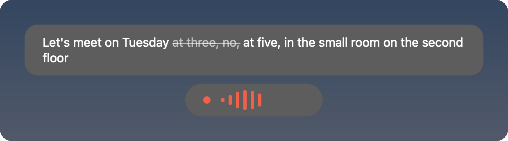

# Dictate

Local dictation for your desktop: hold a key (or a mouse button), talk, let go, and the text
appears at your cursor, in any app. Speech recognition runs on your own machine with open speech
models (**Parakeet Ultra** by default, other models like Nemotron to choose from), on a Mac's
Neural Engine, the CPU or an NVIDIA GPU. Your voice and your text never leave the machine. Made
for macOS; Windows and Linux are in beta.

<p align="center"></p>

- **Fast and private:** 25 European languages with the default model (German and English
  included, detected per recording), about a tenth of a second for a sentence on a Mac, no
  account, no cloud.
- **Your words:** a dictionary for names and jargon, replacements (`so listig => SOLISTIQ`), and it learns
  from the fixes you make right after a paste.
- **Clean text:** spoken commands ("new paragraph", "bullet point"), filler words dropped, and
  optionally a local language model that removes self-corrections ("at three, no, at five") and
  lays out paragraphs and lists.
- **Souffleur** (prototype): listens along in a meeting and lets your Claude Code look things up
  quietly, as short cards beside the call.
- **Talk it over** (prototype): a spoken conversation about the selected text with Claude Code or
  any agent you plug in.
- **For teams:** a shared dictionary and settings from a profile your team keeps in its own repo.

**Platforms:** macOS 14 or later (Apple silicon for the Neural Engine; other Macs use the CPU).
Windows 10/11 and Linux (X11, Wayland) are betas: they build and have the whole dictation loop,
but have not run on real hardware yet ([below](#windows-and-linux-beta)). MIT licensed.

## Install

There is no download yet: Dictate is built from source. On every platform you need
[Rust](https://rustup.rs) (1.99+), [Node.js](https://nodejs.org) (for the settings window) and
CMake; the rest depends on the system.

### macOS (14 or later)

Also needs the Xcode Command Line Tools (`xcode-select --install`); CMake via `brew install cmake`.

```sh
git clone https://github.com/solistiqAI/dictate.git && cd dictate
cargo build --release
./target/release/dictate model download   # Parakeet Ultra for the Neural Engine, 0.6 GB
./scripts/install.sh                      # builds Dictate.app, installs it into /Applications, starts it
```

`install.sh` also links the command line tool as `~/.local/bin/dictate`. On the first start macOS
asks for **Accessibility** (to see your shortcut in other apps and to paste) and the **Microphone**.

macOS ties these permissions to the app's signature. The build is signed ad hoc unless you name a
code signing identity from your keychain, and then macOS asks again after every update:

```sh
DICTATE_SIGN_IDENTITY="Your Name Code Signing" ./scripts/install.sh
```

Optional: `dictate model download gemma-4-e4b` (5 GB) for "Correct" and "Format"; `dictate model
list` shows the other recognition models (CPU, int8, more languages). Something not working:
[troubleshooting](docs/features.md#first-start).

### Windows and Linux (beta)

Both compile and have the whole dictation loop in code (triggers, paste, overlay, tray, settings
window, recognition on the CPU or GPU), but nobody has run them on a real PC or desktop yet, and
there is no installer: you build the binary and start it. In short:

- **Windows 10/11:** Visual Studio 2022 Build Tools ("Desktop development with C++"), then
  `cd ui && npm ci && npm run build && cd ..`, `cargo build --release` (`--features vulkan` or
  `cuda` for the GPU), `dictate model download`, `dictate`. Details:
  [`docs/windows.md`](docs/windows.md).
- **Linux (X11 or Wayland):** the GTK/WebKitGTK `-dev` packages, then the same page build,
  `cargo build --release`, `dictate model download onnxruntime`, `dictate model download`,
  `dictate`. Packages, Wayland setup and details: [`docs/linux.md`](docs/linux.md).

Reports from a first run are very welcome.

## Using it

- **Dictate:** hold Fn (Windows and Linux: right Alt or F13), or the trigger you set: a right-hand
  modifier, F13–F20, a key combination, a mouse button. Speak, let go. A tap starts hands-free
  mode, Esc cancels.
- **Settings** (menu bar or tray icon → Settings): triggers, microphone, language, dictionary, replacements,
  history. The window is in German or English and follows the system.
- **Correct / Format** (in German: Korrigieren / Formatieren): a shortcut that runs the dictation
  through a local model (Gemma 4 E4B via llama.cpp, or Apple's on-device model). It only deletes
  and lays out, and every result is checked against the transcript.
- **Souffleur** and **Talk it over** need [Claude Code](https://claude.com/claude-code). Other agents
  plug into "Talk it over": [`docs/agent-plugins.md`](docs/agent-plugins.md).
- **Command line:** `dictate transcribe file.wav`, `dictate correct "…"`, `dictate format "…"`,
  `dictate eval`, `dictate --help`.

Every feature in detail, with how it was tested: [`docs/features.md`](docs/features.md).

## For teams

What a team shares lives in a **profile**, not in the code: default dictionary words, what the
Souffleur may use and knows about you, which agent answers in "Talk it over", which web pages may
start a dictation, and where anonymous usage reports go (nowhere by default). A team keeps its
profile, icon and signing identity in a private repo of its own, and every machine picks up a changed
profile within a day, without a new build. How: [`docs/teams.md`](docs/teams.md).

## Privacy

Recognition, correction and layout run on your machine, and the history keeps only text. Something
leaves the machine only when you set it up:

- the Souffleur's and "Talk it over"'s messages go to the agent you use (Claude Code: Anthropic's
  terms apply);
- a daily anonymous usage report (counts, timings, problem messages, learned word pairs; never what
  you dictated) goes where your team's profile says: an issue in a private GitHub repo or a URL of
  its own. The built-in profile sends none.

## Development

```sh
cargo test --release && cargo clippy --release --all-targets   # both crates
cd ui && npm ci && npm test && npm run dev                      # the settings window, against a mock
```

- Two crates: `dictate-core` (`core/`, no OS code, builds and tests on Linux) and the app (`src/`,
  OS code in `src/platform/`). Layout and design decisions:
  [`docs/architecture.md`](docs/architecture.md).
- **The eval** measures recognition instead of guessing it: synthetic speech of 32 sentences
  (`eval/sentences.tsv`, rendered with macOS voices) through the model, word error rate and
  dictionary words compared with a committed baseline. Run it before and after changing the
  dictionary, boosting, filters or trimming: `scripts/eval-clips.sh --baseline
  eval/baseline-cpu.json` (pre-rendered clips, any OS) or `scripts/eval.sh --baseline
  eval/baseline.json` (Mac, Neural Engine). `dictate correct --eval eval/corrections.tsv` does the
  same for "Correct".
- Coding agents: [`AGENTS.md`](AGENTS.md).

Issues and pull requests are welcome.

## Models and licences

The app is MIT ([`LICENSE`](LICENSE)); the models are downloaded, not shipped. Parakeet Ultra is
[Moondream's](https://huggingface.co/moondream/parakeet-ultra), built on NVIDIA's
[parakeet-tdt-0.6b-v3](https://huggingface.co/nvidia/parakeet-tdt-0.6b-v3) (both CC-BY-4.0).
Every model with its source and licence, and the third-party code:
[`NOTICE.md`](NOTICE.md) and [`docs/architecture.md`](docs/architecture.md#models).

Made by [SOLISTIQ](https://solistiq.com).
